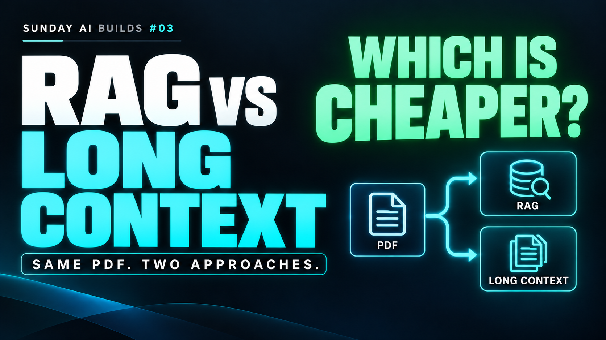
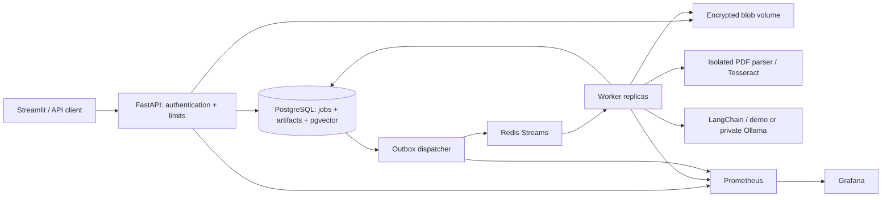

# RAG: When Is It Cheaper Than Long Context?

[](https://youtu.be/d5VAa3C5Wz4)

[](https://youtu.be/d5VAa3C5Wz4)
[](https://www.linkedin.com/in/w-e-ll/)

**▶ [Watch the full project walkthrough · Sunday AI Builds #03](https://youtu.be/d5VAa3C5Wz4)**  
**Contact:** [Valentin Sheboldaev · LinkedIn](https://www.linkedin.com/in/w-e-ll/)

**Sunday AI Builds 03** - one document, two evidence paths, an honest cost/latency/quality experiment.


RAG is not automatically cheaper. Indexing, query embeddings and larger retrieved contexts can outweigh the tokens avoided. This app keeps those tradeoffs visible alongside answer quality and operational health.

## What this version does

- Streams PDF uploads into an encrypted shared blob volume; the HTTP API returns **202 Accepted** after durable job creation.
- Resolves tenant and role from operator-managed access credentials. PostgreSQL runtime queries use tenant filters and **FORCE RLS**.
- Uses **Redis Streams consumer groups**, a PostgreSQL transactional job outbox, heartbeats and lease-fenced finalization. Multiple worker containers can consume safely.
- Extracts native text with font-relative spacing, reconstructs table cells, and runs **Tesseract OCR** on scans and images within mixed pages. Optional private **Qwen2.5-VL** adds diagram descriptions and scanned-table extraction, with explicit uncertainty and review before indexing. See [PDF extraction and local vision setup](docs/ingestion.md).
- Uses **LangChain recursive splitters**, a consistent token budget, and either direct child retrieval or bounded **parent-child expansion**. Page provenance is retained.
- Reuses unchanged embeddings within a tenant and embedding-model fingerprint. The same reviewed source feeds the full-context and retrieval arms.
- Saves paired answers, usage source, model/configuration/price snapshots, source hashes, stage latency, signed estimated savings and a strict break-even question count.
- Provides a **Streamlit client dashboard** and provisioned **Prometheus/Grafana operations dashboard** with alert rules.

The default is an explicitly synthetic lexical demo: no external AI calls, no key required. Optional **private Ollama** models provide real local embeddings and generation. PDF ingestion defaults to an OCR-first profile on modest hardware; local vision is an experimental add-on and is never required to preserve baseline text or tables. Token-price calculations are scenario estimates, not an invoice for running a local model.

The intended company deployment uses local models and English documents. See
[production release gates](docs/production-readiness.md) for implemented startup guards,
verification evidence and remaining blockers. This build is not production-released.

## Architecture



The blob adapter is a shared Docker named volume for this portfolio build. This supports multiple containers on one Docker host. Multi-host deployment requires an S3-compatible or equivalent shared object-store adapter; independent local disks are not supported.

## Quick start - Windows / PyCharm / Docker

From this project directory (Python 3.13, uv and Docker Desktop Linux engine required):

```powershell
uv sync --frozen
uv run python scripts/setup.py
./scripts/docker.ps1 Up -Workers 2
./scripts/docker.ps1 Verify
```

On a fresh clone, run Setup to generate local secrets and demo credentials. If `.env` already exists, **skip Setup**. Setup preserves existing files. Generated credentials stay in ignored files and are not included in the repository; never commit them.

- UI: http://localhost:8503
- API docs: http://localhost:8003/docs
- Grafana: http://localhost:3003 (user `operator`; password is `GRAFANA_PASSWORD` in `.env`)
- Prometheus: http://localhost:9093

These localhost ports are published by the Nginx `gateway`. Application services remain on internal networks. Use `docker compose port gateway 8003` to inspect the API binding.

Open `.demo-credentials.json` locally and use an `alpha` or `beta` access token in the UI. Each tenant sees only its own resources. These are demo service credentials, **not an implemented enterprise SSO/login flow**.

## Try the experiment

1. Upload `examples/nist-mixed-fixture.pdf`: a **modified public NIST extract**, 9 pages with prose, diagrams, tables and two raster-only pages.
2. Refresh Documents until `review`. Compare extracted evidence with the PDF. Correct tables, OCR errors and diagram descriptions. Approve the reviewed text.
3. Start with `recursive`, 450-token children and 60-token overlap. Refresh until `ready`.
4. Open Experiment. Ask: **What are the four AI RMF core functions?** Reference facts: GOVERN, MAP, MEASURE, MANAGE.
5. Compare answers, generation tokens/latency and the first-question cost including indexing. Inspect retrieved pages. Increase projected question count to see amortization.
6. Reindex the same reviewed evidence with `parent_child`, keeping model and questions unchanged. Parent expansion is deduplicated and constrained by the retrieved context budget.
7. Repeat with the table, scanned-page and unanswerable questions in `examples/questions.json`. Human review is necessary for diagram relationships, citation correctness and abstention.
8. Switch to the beta token and confirm the alpha documents and runs are inaccessible.

A smaller fixture is suitable for a demo; `examples/nist-ai-rmf-original.pdf` is the complete 48-page source. The long-context arm refuses documents beyond its configured experiment limit instead of silently truncating.

## Cost and quality

`RAG(N) = cumulative document indexing estimate + N * (query embedding estimate + RAG generation estimate)`

`LongContext(N) = N * full-context generation estimate`

Savings remain signed: a negative value is additional cost. The break-even result is the first integer N where RAG is **strictly cheaper**; equality is not savings. Projections assume the observed per-question cost repeats, which heterogeneous workloads may not satisfy.

Generation usage is `synthetic` in demo mode and `model_reported` in Ollama mode. Embedding counts use the explicitly documented `cl100k_base` proxy tokenizer. Shared parsing/review, infrastructure, local model energy, labour and incomplete inference attempts are outside the USD scenario. Model-price values are editable illustrative assumptions, not current provider prices. See [experiment methodology](docs/live-experiment.md).

## Monitoring and optimization

Grafana is an operator-only aggregate view: service reachability, queue depth/age, job failures, stage p95 latency, API 5xx ratio and embedding reuse. Metrics contain no tenant IDs, questions, answers or PDF text. Alert rules are included; external notifications and Alertmanager are not configured.

Client-facing savings and quality are in Streamlit. Do not substitute lower cost for sufficient answer quality. Semantic chunking, reranking and larger parents need a measured improvement before adoption.

## Project map

```text
rag_lab/
  api/          authentication, body/rate limits, validated HTTP endpoints
  core/         contracts, chunking, providers, accounting, security, metrics
  db/           PostgreSQL schema, RLS-scoped repository, leases/outbox
  ingestion/    encrypted blob adapter and isolated PDF/OCR process
  ui/           Streamlit API client
  worker.py     Redis consumer and pipeline execution
  queue.py      outbox dispatcher and queue metrics
migrations/     versioned schema and RLS policies
docker/         initial least-privilege database roles
monitoring/     Prometheus, alert rules and Grafana provisioning
examples/       public PDF, mixed fixture, manifest and question set
tests/          unit, API, PDF, UI and isolated PostgreSQL checks
scripts/        setup and Windows lifecycle helper
docs/           architecture, security, operations and measurement limits
```

## Verification

```powershell
uv run pytest -q
uv run ruff check .
uv run ruff format --check .
./scripts/docker.ps1 Test
```

The Docker tests use a separate `rag_lab_test` database. See [verification record](docs/verification.md) for checks actually executed in the build session. Never point tests at the application database.

## Daily operations

```powershell
docker compose logs --tail 100 api dispatcher worker parser
docker compose up -d --scale worker=3
./scripts/docker.ps1 Down
```

`Down` preserves volumes. Do not use `down -v` to fix startup. Back up the database, encrypted blobs and encryption key together; a database dump alone cannot restore source PDFs. See [Docker operations](docs/docker.md).

## Security and production boundary

This is a multi-tenant portfolio implementation with executable isolation mechanisms, **not a certified confidential-document production service**. Real customer deployment still requires enterprise identity and credential rotation, TLS, managed keys, object-store policy/encryption, backups/restore testing, malware/CDR policy, per-document ACLs if required, quotas/retention policy, deployment hardening and an independent security review. Confidential input is not sent to hosted AI or hosted tracing. Read [security model and limits](docs/security.md) before handling real documents.

## References

- [NIST AI RMF 1.0](https://nvlpubs.nist.gov/nistpubs/ai/NIST.AI.100-1.pdf)
- [LangChain text splitters](https://docs.langchain.com/oss/python/integrations/splitters/index)
- [pgvector](https://github.com/pgvector/pgvector)
- [PostgreSQL row security](https://www.postgresql.org/docs/current/ddl-rowsecurity.html)
- [Redis XAUTOCLAIM](https://redis.io/docs/latest/commands/xautoclaim/)
- [Prometheus Python histograms](https://prometheus.github.io/client_python/instrumenting/histogram/)
